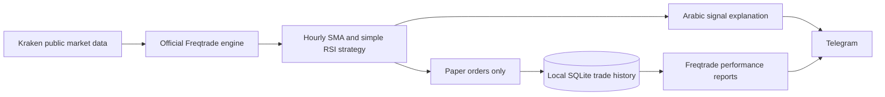

# Architecture

The Docker container mounts the strategy and public configuration, plus a private credential file. No API server or host port is exposed. No exchange trading credential is configured. `--dry-run`, `dry_run: true`, and a live-mode rejection in the strategy express the paper-only scope; users able to edit code can of course modify these safeguards.

The strategy uses rolling indicators without forward-looking shifts. Freqtrade supplies completed OHLCV candles. Entry confirmation rejects candles less than one hour old or older than 7,500 seconds from their opening timestamp. This tolerates delayed polling and does not substitute for a full data-integrity monitor.

SQLite persists trades across restarts. Telegram strategy-message caching is per candle and not a guarantee of exactly-once notification delivery across restarts. Do not run multiple containers against the same database. Back up local data before changing the pinned engine version.
