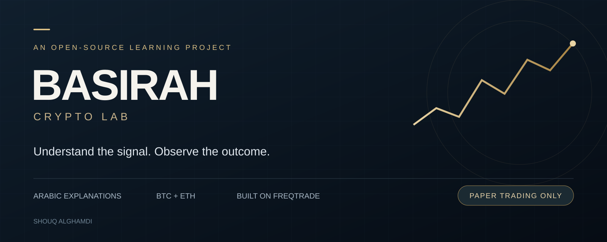

<div align="center">



# بصيرة · Basirah Crypto Lab

**Understand the signal. Observe the outcome.**

Arabic explanations · BTC & ETH · Paper trading · Built on Freqtrade

[العربية](docs/README.ar.md) · [How it works](docs/ARCHITECTURE.md) · [Security](SECURITY.md) · [Upstream Freqtrade](https://github.com/freqtrade/freqtrade)

</div>

## A trading experiment you can understand

Basirah is an educational configuration and strategy extension for **the original Freqtrade engine**. It monitors BTC/USD and ETH/USD, explains rule-based signals in Arabic through Telegram, and records simulated trades and performance.

**Paper trading only.** This project does not connect a wallet or execute real-money trades. It is a learning project, not a profitable-strategy claim, an AI price predictor, or investment advice.

### What is included

| Capability | Implementation |
|---|---|
| Trading engine | Official Freqtrade Docker image, version 2026.9 |
| Market data | Kraken public data, hourly candles |
| Explainable signals | SMA20, SMA50 and simple 14-period RSI |
| Arabic delivery | Custom strategy messages through Freqtrade's Telegram integration |
| Paper portfolio | 1,000 virtual USD; 100 USD stake; at most two open trades |
| Performance | Freqtrade's SQLite history and Telegram reports |
| Reproducible checks | Strategy tests and GitHub Actions workflow |

The underlying Freqtrade engine is maintained by its upstream contributors. This repository contributes the educational configuration, custom strategy, Arabic explanations, tests, and documentation. It is an independent extension, not the upstream project or an official Freqtrade product.

## Quick start

Install Docker Desktop or Docker Engine with Compose, plus Python 3 for the local setup helper. Clone this repository, then run from its directory:

```sh
python3 setup.py
docker compose pull
docker compose up -d
docker compose logs --tail 50 -f
```

The setup helper accepts Telegram credentials locally with hidden token input. Leave the token blank to run without Telegram. If using Telegram, first send `/start` to your bot. Credentials are saved in an ignored `private/telegram.json` file with restricted permissions; never commit that folder.

Look for `state='RUNNING'` and the dry-run startup message. A running container alone does not prove that market data or Telegram works. The first usable signal may take a moment to load. Stop the log view with Ctrl+C; stop the bot with `docker compose stop`.

No exchange API key is needed. Keep the computer awake, Docker running, and the network connected. To restart the stopped container, use `docker compose up -d`.

### Telegram commands

| Command | Purpose |
|---|---|
| `/status` | Open simulated positions |
| `/profit` | Performance summary |
| `/daily` | Daily performance |
| `/balance` | Virtual balance |
| `/performance` | Results by trading pair |

Arabic messages explain signals; Freqtrade's standard system and trade messages may be in English. A signal message is not a fill confirmation. Messages can repeat after a restart; trade state is persisted separately by Freqtrade.

## Strategy, in plain language

Enter a long paper position when SMA20 is above SMA50, simple RSI14 is between 45 and 70, and volume is positive. Exit on a weaker trend or RSI below 40, subject to Freqtrade's execution logic. A 3% stop-loss and 6% ROI target are configured. They do not guarantee exit prices during gaps or outages.

RSI uses simple rolling averages, not Wilder smoothing. Fees are modeled at 0.26% per side; that is an assumption, not a verified fee tier. Fills use Freqtrade's dry-run model rather than the exact behavior of a funded exchange account. Signals use closed candles; entries reject missing, unclosed, or stale data. Risk exits are handled by Freqtrade's engine.

## Validation

The original deployment was observed running Freqtrade 2026.9 in dry-run mode on October 10, 2026. Its database recorded simulated BTC/USD and ETH/USD entries, and the log showed Arabic messages queued for Telegram. This is operational evidence, not a return benchmark. Private logs and trading history are intentionally excluded.

The test suite covers flat-market waiting, downtrend exits, entry conditions, zero volume, future-data independence of indicators, rejection of live mode, and stale/unclosed entry rejection. Run it inside the same official image:

```sh
docker run --rm --entrypoint python \
  -v "$PWD/user_data/strategies:/freqtrade/user_data/strategies:ro" \
  freqtradeorg/freqtrade:2026.9 \
  -m unittest discover -s user_data/strategies -p 'test_*.py' -v
```

The repository includes CI for these checks; see the Actions tab for actual results. Unit tests do not establish profitability. No out-of-sample performance study has been completed.

## Next steps

- Evaluate more market regimes with historical data and out-of-sample testing.
- Improve the Arabic explanations and performance reports.
- Add clearer health monitoring for data and notification outages.

Real-money execution is outside this release's scope. Both the launcher and strategy enforce the paper-only intent.

## Credits and license

Built by **Shouq Alghamdi** with AI-assisted implementation, on top of [Freqtrade](https://github.com/freqtrade/freqtrade). Freqtrade supplies the engine, exchange integration, persistence and Telegram infrastructure. This repository is distributed under GPL-3.0; see [LICENSE](LICENSE).
